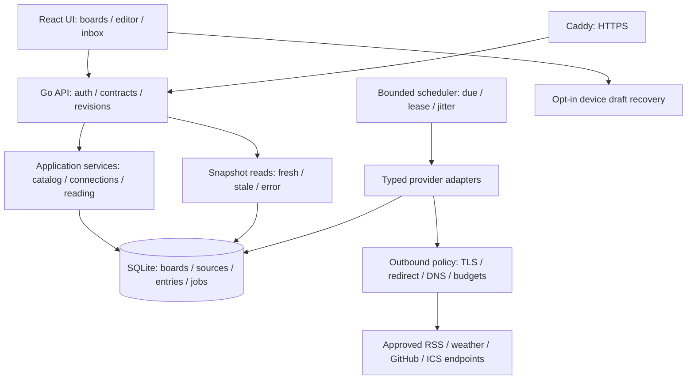

# 개인 정보 대시보드의 다음 아키텍처

상태: 구현에 앞서 정한 설계 기준. 작성일 2026-10-21.
기준 구현은 커밋 `6a4275b`의 개인용 출시 후보다. 아래 새 구조가 이미
구현됐다는 의미가 아니다. [80단계 실행 계획](../frontier-implementation-plan.md)과
[저장소 비교](../research/related-repositories.md)를 함께 본다.

## 목표와 경계

소유자 한 명이 뉴스·날씨·일정·개발 정보·메모·링크를 자기 맥에서 모으고,
빠르게 편집하며, 출처와 최신 상태를 믿고 사용할 수 있는 정보 작업 공간을
만든다. 화면의 완성도, 확장성, 복구 가능성, 측정 가능한 품질을 함께 높인다.
개인용이라는 기존 합의는 유지한다. 기능이 늘어도 기본 실행 구성은 앱 하나,
SQLite 파일, 선택적인 HTTPS 프록시로 유지한다.

## 결정

| 결정 | 선택 및 이유 | 재검토 조건 |
| --- | --- | --- |
| A1 실행 구조 | Go 모듈식 단일 서버 + React/TypeScript + SQLite 유지. 현재 동작하는 배포·인증·복구 경로를 확장한다. | 단일 맥의 측정된 병목이 쿼리·인덱스·작업 제한으로 해결되지 않을 때 |
| A2 계약 | Go의 위젯/provider catalog에 type, configVersion, capabilities, 설정 schema, 검증기와 캐시 정책을 등록한다. OpenAPI에서 TS 계약을 생성·검사한다. 보안 검증은 서버가 최종 권한을 갖는다. | schema 표현이 불가능한 설정은 명시적인 custom validator와 동일 fixture 사용 |
| A3 데이터 모델 | 보드는 versioned JSON aggregate + CAS revision을 유지한다. 공유 source, connection, entry/read state는 별도 테이블로 분리한다. | 새 관계가 생길 때만 정규화; 위젯의 모든 속성을 EAV 테이블로 만들지 않음 |
| A4 갱신 | SQLite의 next_run/lease 정보를 사용하는 bounded scheduler, HTTP 조건부 GET, jitter/backoff/host budget. 처음에는 polling을 유지한다. | 실제 측정에서 polling 지연·전송량이 기준을 넘으면 SSE 실험; Redis는 기본 요구하지 않음 |
| A5 확장 | 빌드에 포함되는 신뢰된 adapter와 명시적 기능 목록. API key·capability는 connection에 귀속한다. | 외부 플러그인은 별도 sandbox·서명·권한 모델을 설계한 뒤 독립 결정 |
| A6 프론트 상태 | 서버 데이터, 편집 draft, 선택/모달 상태를 분리한다. query key에 owner/board/revision을 포함하며 로그아웃 시 private cache를 삭제한다. | Query 라이브러리 실험이 기존 polling보다 정확성·유지보수 이점을 입증하지 못하면 현 구조 유지 |
| A7 배치 | 현재 순서형 배치와 small/wide 의미를 보존하고 키보드·터치 정렬을 먼저 개선한다. 자유 그리드는 별도 spike로 검증한다. | GridStack이 접근성·영속화·모바일 품질을 입증할 때만 좌표 배치 schema를 도입 |
| A8 검색 | SQLite FTS5를 기본 후보로 하며 한국어·짧은 검색어 fixture를 먼저 검증한다. 외부 검색 서버를 기본 요구하지 않는다. | 명시된 1만 항목 검색 품질·지연 목표에 실패하면 대안 비교 |
| A9 프라이버시 | 서버 응답/내보내기에 credential을 포함하지 않는다. connection secret은 외부 key file로 암호화하고 key rotation·복구 절차를 갖춘다. | 운영 환경에서 별도 secret manager가 실제 제공될 때 adapter로 교체 |
| A10 지능형 기능 | 출처 있는 결정적 오늘 브리핑을 기본으로 만들고 LLM 요약은 선택 기능으로 분리한다. 기본 동작에 유료 API를 요구하지 않는다. | 사용자 키/선택한 로컬 모델·비용 상한·출처 검증이 준비됐을 때 활성화 |

## 요청과 데이터 흐름



Node는 UI 빌드와 개발에 사용하며 운영 앱의 필수 프로세스로 추가하지 않는다.
스케줄러와 API는 같은 프로세스에서 실행하고 종료 시 함께 취소한다. 예약 작업은
브라우저가 닫혀도 수집하지만, 맥이 꺼지거나 잠들었을 때까지 동작한다고 주장하지 않는다.

## 코드 경계

새 디렉터리는 실제 책임이 분리될 때만 만든다. 한 번에 전체 파일을 옮기지 않는다.

```text
internal/dashboard/
  catalog/       widget/provider definitions, config versions and capabilities
  application/   board, connection and reading use cases
  storage/       migrations, repositories, search and job leases
  providers/     RSS, weather, GitHub, ICS and restricted JSON adapters
  transport/     HTTP DTOs, auth middleware and outbound policy
  runtime/       refresh, deduplication, retry and retention
web/src/
  app/           shell, navigation and session lifecycle
  features/      boards, editor, connections, inbox and search
  widgets/       renderer registry and widget-specific settings/preview
  shared/        accessible UI, generated contracts and query policy
```

기존 `internal/glance/` YAML renderer는 별도 모드로 유지한다. 필요한 수정만
공유하고 dashboard 전용 기능을 기존 renderer로 새어 넣지 않는다.

## 데이터와 호환성

- `boards`: board_id, owner_id=`local`, revision, document. 한 보드의 위젯 배치는
  여전히 하나의 트랜잭션으로 저장한다. 임의 user_id를 클라이언트에서 받지 않는다.
- `sources`: owner-scoped ID, provider type, config version, 비밀이 아닌 설정과
  connection_id. 동일 원천을 여러 보드에서 참조할 수 있다.
- `connections`: provider kind, secret reference, 허용 endpoint와 capability.
  credential·private calendar URL의 token 부분은 평문 board/source JSON에 두지 않는다.
- `entries`와 `entry_state`: 안정된 provider/source item identity, 원문 URL,
  제한된 발췌문, 발행/수집 시각, 읽음·저장·태그. 캐시 삭제와 사용자의 저장을 분리한다.
- `snapshots`: config/connection identity를 포함한 cache key, 마지막 성공,
  만료, 재시도, provider-specific HTTP validators와 정제한 오류 분류.
- `refresh_jobs`: due time, lease deadline, source generation. 재시작·설정 변경·
  삭제 이후에 오래된 작업이 새 설정의 결과를 덮어쓰지 못하게 한다.

초기 운영 예산 후보는 10개 보드, 보드당 32개 위젯, 총 128개 source, 동시
수집 4개/호스트당 2개, 검색 1만 항목이다. 아직 측정된 보장이 아니며 F016에서
확정하고 상한 변경에는 데이터 크기·메모리·대기 시간을 다시 측정한다.

스키마 마이그레이션은 순서 있는 버전과 fixture로 관리한다. 현재 v1의 home
보드·source·snapshot을 보존하고, import envelope v1과 기존 dashboard API를
호환 경로로 유지한다. 새 기능의 export에는 별도 format version을 부여한다.
DB revision, configVersion, API version은 서로 다른 의미다.

FTS5는 go-sqlite3 빌드 태그 `sqlite_fts5`가 필요하므로 native·Docker·CI 빌드와
runtime capability probe를 함께 변경한다. 한국어는 unicode tokenizer만으로
형태소 검색이 완성된다고 가정하지 않는다. trigram/정규화 및 1~2글자 입력의
제한된 fallback을 fixture와 실제 쿼리 계획으로 비교한다.

## 수집·연동의 규칙

HTTPS·응답 크기·시간 제한·리다이렉트 제한과 연결 시점 DNS/IP 검사를 유지한다.
managed cloud의 proxy/CA를 보존한다. 공개 source와 개인 LAN source를 동일한
권한으로 취급하지 않으며, 기본값은 private network 거부다. LAN 연동은 사용자가
정한 정확한 endpoint와 별도 egress 정책을 갖추기 전에는 제공하지 않는다.

HTTP 304는 마지막 성공 자료를 유지하며 freshness를 갱신한다. 429/503의
Retry-After, timeout, 네트워크 끊김을 구분하고 상한 있는 backoff와 jitter를
적용한다. source 저장 직후 재수집은 quota·권한을 통과한 작업만 수행한다.
앱 시작 시 밀린 모든 작업을 동시에 실행하지 않는다.

GitHub 등 credential 연동은 최소 권한·연결 테스트·만료/철회 상태를 제공한다.
실제 사용자 credential이 없으면 fixture 검사만 완료로 표시한다. 범용 JSON은
안전한 JSON Pointer와 제한된 표시 타입만 지원하고 JS/template 실행 기능을
넣지 않는다. RSSHub/Bridge는 기존 피드 URL을 통해 연결한다.

## 편집·오프라인·비밀정보

편집은 명령 단위 undo/redo와 immutable draft로 처리한다. 저장은 CAS revision을
사용하며 다른 탭의 최신 데이터를 자동 덮어쓰지 않는다. 재로그인 후 메모리 draft
유지는 현재 동작을 보존한다. 기기 내 영속 draft는 사용자가 켠 경우에만 저장하고
저장 범위·보관 기간을 설명하며 로그아웃 시 삭제한다. connection secret은 draft나
IndexedDB, localStorage, service worker cache, export에 들어가지 않는다.

PWA는 앱 shell부터 시작한다. 인증 API 응답을 service worker에서 무차별 캐시하지
않으며, 오프라인 변경 사항은 자동 업로드하지 않는다. 재연결 시 revision을
검사하고 사용자가 저장한다. 로그아웃·세션 만료·공유 기기의 저장 정책을 별도로
검증한다. 오프라인 보기와 인터넷 없이 외부 데이터를 갱신하는 기능은 구분한다.

## 완료 판단

각 단계의 코드·계약 변경 → 관련 검사 → 통합 gate → 증거 기록 순서를 지킨다.
하나의 데모 화면, 테스트 수 증가, 문서 추가만으로 새 기능을 완료 처리하지 않는다.
가동·메모리·성능 수치는 환경과 부하 조건을 함께 기록한다. 맥 미니 실기기,
공인 도메인 TLS, 실제 비밀 연동은 외부 조건이 마련될 때까지 미검증 상태다.
